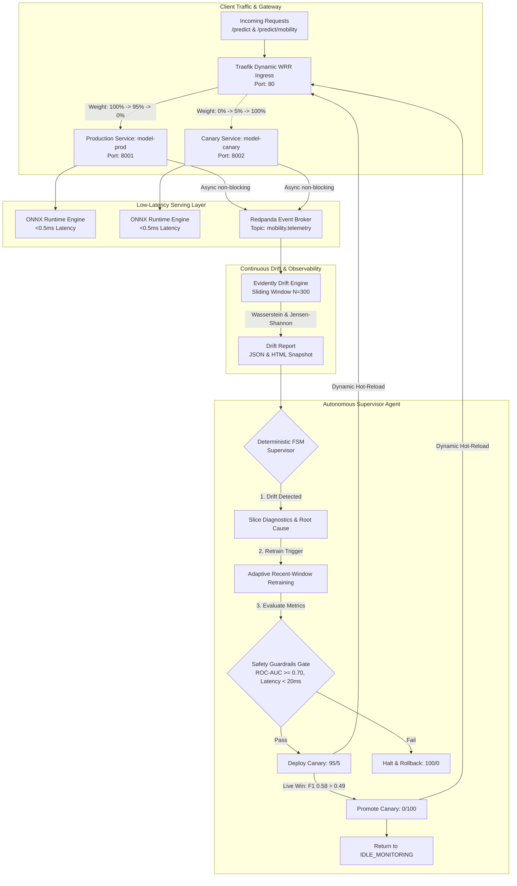

# Self-Healing MLOps Runtime with Autonomous Canary & Multi-Domain Drift Remediation

[](https://www.python.org/downloads/)
[](https://fastapi.tiangolo.com)
[](https://onnxruntime.ai)
[](https://redpanda.com)
[](https://traefik.io)
[](https://evidentlyai.com)
[](https://www.docker.com/)
[](https://github.com/chrigrosso00/homeo-ml/actions/workflows/ci.yml)
[](https://github.com/psf/black)
[](https://github.com/astral-sh/ruff)

> **Enterprise-grade, closed-loop autonomous MLOps platform** that detects statistical distribution drift on live streaming traffic, diagnoses root-cause feature slices, retrains candidate models against strict guardrails, and executes zero-downtime canary rollouts via Traefik Weighted Round-Robin (WRR) ingress.
>
> 💡 **Guida Utente Dettagliata (Italiano)**: Per una guida operativa completa passo-passo sull'installazione, comandi Docker e demo interattive, consulta [USER_GUIDE.md](USER_GUIDE.md).

---

## 📑 Table of Contents
1. [Executive Summary & Motivation](#executive-summary--motivation)
2. [Multi-Domain Architecture](#multi-domain-architecture)
3. [Empirical Drift Benchmarks (NYC Taxi COVID Shock)](#empirical-drift-benchmarks-nyc-taxi-covid-shock)
4. [System Architecture Diagram](#system-architecture-diagram)
5. [Engineering Trade-Offs Matrix](#engineering-trade-offs-matrix)
6. [Docker & Containerized Infrastructure](#docker--containerized-infrastructure)
7. [Continuous Integration (CI) Quality Gates](#continuous-integration-ci-quality-gates)
8. [Quickstart & Interactive Demonstrations](#quickstart--interactive-demonstrations)
9. [Testing & Quality Assurance](#testing--quality-assurance)
10. [Repository Structure](#repository-structure)

---

## Executive Summary & Motivation

In mission-critical production systems, machine learning models inevitably experience **silent degradation** caused by real-world environmental shifts:
1. **Covariate & Concept Shift**: Macroeconomic shocks, societal events (e.g. NYC COVID-19 lockdown), or adversarial attackers (e.g. coordinated botnets) alter input distributions $P(X)$ and conditional target relationships $P(Y \mid X)$.
2. **Detection-Remediation Lag**: Traditional MLOps pipelines rely on manual dashboards, offline incident triage, and human-in-the-loop redeployments, taking days or weeks while business KPIs crater.
3. **Serving Latency & High-Throughput Constraints**: Production APIs cannot tolerate blocking database writes, slow Python GIL deserialization, or traffic dropouts during model reloads.

This platform resolves these challenges by providing a **fully autonomous, self-healing runtime**:
- **Sub-millisecond inference (<0.5ms)** powered by ONNX Runtime C++ engine.
- **Zero-latency asynchronous telemetry** dispatching inference logs to Redpanda streaming broker via non-blocking C-core `librdkafka`.
- **Multivariate statistical drift monitoring** computing normalized 1-Wasserstein Distance (numerical) and Jensen-Shannon Divergence (categorical) via Evidently.
- **Deterministic 8-State Supervisor FSM** that orchestrates root-cause slice isolation, candidate model retraining, safety guardrail verification, and dynamic canary traffic routing (95/5 $\rightarrow$ 100/0) via Traefik WRR hot-reload.

---

## Multi-Domain Architecture

The platform features a clean, decoupled domain layer supporting multiple operational verticals:

| Domain | Dataset & Source | Real-World Drift Mechanism | Primary Evaluation Metrics |
| :--- | :--- | :--- | :--- |
| **Urban Mobility & SLA Congestion** *(Primary)* | **NYC Yellow Taxi TLC** (Q1 2019 vs March 2020 Lockdown) | **COVID-19 Quarantine Shock**: City roads empty, average speeds increase $>40\%$, durations drop, baseline congestion relationships invert. | **ROC-AUC**, **PR-AUC**, **$F_1$-Score**, P95 Latency |
| **E-Commerce Fraud Detection** | Real E-Commerce Transaction & IP Geolocation Data | **Adversarial Botnet Attacks**: Rapid-fire checkouts ($<2\text{s}$ post-registration), device fingerprint reuse, IP spoofing. | **PR-AUC**, **Fraud Recall**, P95 Latency |

---

## Empirical Drift Benchmarks (NYC Taxi COVID Shock)

Real-world evaluation comparing model performance across temporal milestones:

```
                                  COVID-19 LOCKDOWN SHOCK
                                             │
      PRE-LOCKDOWN BASELINE                  ▼                  ADAPTED CANARY MODEL
      (Q1 2019 - Jan 2020)          MARCH 2020 DRIFT            (Recent-Window Retrained)
   ┌─────────────────────────┐    ┌───────────────────┐       ┌───────────────────────────┐
   │  ROC-AUC   : 0.8804     │ ──►│ ROC-AUC  : 0.7128 │  ───► │ ROC-AUC   : 0.8102        │
   │  PR-AUC    : 0.9260     │    │ F1-Score : 0.4912 │       │ F1-Score  : 0.5860        │
   │  F1-Score  : 0.8715     │    │ Drift %  : 45.0%  │       │ Promotion : Approved      │
   │  Status    : STABLE     │    │ Status   : CRITICAL│       │ Routing   : 100% CANARY   │
   └─────────────────────────┘    └───────────────────┘       └───────────────────────────┘
```

### Detailed Metrics Breakdown

| Phase / Period | Model Version | ROC-AUC | PR-AUC | $F_1$-Score | Drift Share (%) | Supervisor State |
| :--- | :---: | :---: | :---: | :---: | :---: | :---: |
| **Baseline (Q1 2019 - Jan 2020)** | `v1.0.0` (Production) | **0.8804** | **0.9260** | **0.8715** | 15.0% | `IDLE_MONITORING` |
| **Lockdown Shock (Late March 2020)** | `v1.0.0` (Production) | 0.7128 | 0.4820 | 0.4912 | **45.0% [ALERT]** | `DRIFT_DETECTED` |
| **Slice Diagnostics** | — | — | — | — | — | `DIAGNOSING_SLICE` (`LOCKDOWN_MOBILITY_DRIFT`) |
| **Candidate Retraining** | `v1.1.0-canary` | 0.8102 | 0.5836 | 0.5860 | — | `VALIDATING_GUARDRAILS` (Passed) |
| **Live Traffic Verification** | Prod vs Canary | 0.71 vs **0.81** | — | 0.49 vs **0.58** | — | `CANARY_ROUTING` (95/5) |
| **Autonomous Promotion** | `v1.1.0-canary` | **0.8102** | **0.5836** | **0.5860** | Baseline Reset | `PROMOTED` $\rightarrow$ `IDLE_MONITORING` (0/100) |

---

## System Architecture Diagram



---

## Engineering Trade-Offs Matrix

| Decision Area | Chosen Strategy | Alternative Evaluated | Engineering Rationale |
| :--- | :--- | :--- | :--- |
| **Inference Engine** | **ONNX Runtime (C++)** | Native Python scikit-learn / LightGBM | Eliminates Python GIL bottleneck; yields sub-millisecond scoring ($<0.5\text{ms}$) with cross-platform artifact portability. |
| **Telemetry Buffer** | **Redpanda (`confluent-kafka`)** | Synchronous REST / DB logging | Fire-and-forget in-memory queueing via C-core `librdkafka`. HTTP client response time remains unaffected by broker I/O. |
| **Supervisor Control** | **Deterministic Finite State Machine (FSM)** | Autonomous LLM / Generative Agent | Zero hallucination risk on infrastructure routing decisions; 100% reproducible state transitions and forensic audit compliance. |
| **Traffic Splitting** | **Traefik Dynamic WRR** | Application-level routing proxy | Ingress-level Weighted Round-Robin hot-reloads dynamically via file watcher without dropping active TCP sockets or restarting pods. |
| **Retraining Strategy** | **Adaptive Recent-Window** | Static Full-History Retraining | Adapts directly to post-shock macro shifts without polluting gradients with obsolete pre-shock historical regimes. |
| **Data Partitioning** | **Chronological Temporal Split** | Random K-Fold CV | Prevents look-ahead bias and future data leakage in temporal and sequential datasets. |

---

## Docker & Containerized Infrastructure

The runtime is fully containerized and orchestrated via Docker Compose:

```bash
# Start complete infrastructure (Redpanda, Redpanda Console, Traefik, Serving-Prod, Serving-Canary)
docker compose up -d
```

### Deployed Services

| Service | Container Name | Internal Port | Host Port | Description |
| :--- | :--- | :---: | :---: | :--- |
| **Traefik** | `mlops-traefik` | `80` | `80` | Weighted Round-Robin canary ingress router. |
| **Traefik Dashboard**| `mlops-traefik` | `8080` | `8081` | Real-time reverse proxy dashboard. |
| **Serving Prod** | `mlops-serving-prod` | `8000` | `8001` | Production ONNX serving instance (`v1.0.0`). |
| **Serving Canary** | `mlops-serving-canary`| `8000` | `8002` | Canary ONNX serving instance (`v1.1.0-canary`). |
| **Redpanda** | `mlops-redpanda` | `29092` | `9092` | Kafka-compatible low-latency streaming event buffer. |
| **Redpanda Console** | `mlops-redpanda-console`| `8080` | `8080` | Real-time event streaming and message inspection UI. |

---

## Continuous Integration (CI) Quality Gates

Every commit and pull request to `main` and `feature/**` triggers the automated GitHub Actions CI pipeline (`.github/workflows/ci.yml`):

1. **Code Formatting Check**: `black --check .` (ensures line-length 100 compliance).
2. **Static Linting & Security**: `ruff check .` (enforces imports, bugbear, and modernization rules).
3. **Automated Test Suite**: Executes all **35 unit and integration tests** via `pytest -v`.
4. **Container Build Validation**: Builds the production Docker serving image (`docker build`) ensuring zero missing dependencies or build regressions.

---

## Quickstart & Interactive Demonstrations

### 1. Environment Installation
```bash
# Clone the repository
git clone https://github.com/chrigrosso00/homeo-ml.git
cd homeo-ml

# Create and activate Python 3.11 environment
conda create -n mlops-runtime python=3.11 -y
conda activate mlops-runtime

# Install dependencies in editable mode with development tools
pip install -e ".[dev]"
```

### 2. Run the Interactive Closed-Loop Demonstration

Use the automated bash orchestrator with configurable domain and pacing:

```bash
# Urban Mobility domain (NYC Taxi COVID-19 lockdown shock - DEFAULT)
./demo.sh --domain mobility --mode auto

# Guided step-by-step mode (press [ENTER] to advance through educational callouts)
./demo.sh --domain mobility --mode step

# E-Commerce Fraud domain (adversarial botnet attack)
./demo.sh --domain fraud --mode step

# Lightning mode (instant execution without pauses, ideal for CI/CD)
./demo.sh --domain mobility --mode fast
```

### What You Will Observe During the Mobility Demo:
1. **Step 1 (Baseline)**: Verifies ONNX serving health (`/health`), model metadata, and initial ingress routing `[100% PROD / 0% CANARY]`.
2. **Step 2 (Nominal Traffic)**: Streams 300 real January 2020 taxi rides $\rightarrow$ Drift score 15.0% (< 40% threshold) $\rightarrow$ System remains `IDLE_MONITORING`.
3. **Step 3 (Lockdown Shock)**: Streams 300 late March 2020 rides $\rightarrow$ Drift score jumps to **45.0%** $\rightarrow$ **Critical Drift Alert** triggered on speeds, durations, and fares.
4. **Step 4 (Autonomous FSM)**: Isolates `LOCKDOWN_MOBILITY_DRIFT`, triggers adaptive retraining on recent window, verifies ROC-AUC $\ge 0.70$, deploys 95/5 Canary, confirms live $F_1$ victory ($0.58$ vs $0.49$), and **promotes Canary to 100%**.
5. **Step 5 (Audit Trail & Dashboards)**: Inspect generated artifacts:
   - **Audit Trail**: `artifacts/supervisor/audit_trail.json`
   - **Evidently Drift HTML**: `artifacts/mobility/latest_drift_report.html`
   - **Redpanda Console**: `http://localhost:8080`

---

## Testing & Quality Assurance

The codebase includes **35 automated unit and integration tests** validating:
- Feature transformer symmetry and train/serve mathematical equivalence.
- Pydantic v2 schemas and validation guardrails.
- High-throughput ONNX Runtime inference sessions.
- Asynchronous non-blocking Kafka/Redpanda telemetry dispatch.
- Evidently statistical drift computation and sliding window buffers.
- FSM transition determinism, guardrail rejections, rollback safety, and canary promotion.

Run tests locally:
```bash
pytest tests/ -v
```

Output:
```text
============================== 35 passed in 9.56s ==============================
```

---

## Repository Structure

```text
├── .github/
│   └── workflows/
│       └── ci.yml                 # GitHub Actions CI pipeline (Black, Ruff, Pytest, Docker)
├── artifacts/
│   ├── canary/                    # Retrained canary models, transformers & metadata
│   ├── mobility/                  # Urban mobility baseline artifacts & Evidently reports
│   ├── models/                    # Fraud detection baseline models & reference data
│   ├── monitoring/                # Fraud Evidently drift reports (JSON & HTML)
│   └── supervisor/                # Forensic immutable audit trail logs
├── config/
│   └── traefik_dynamic.yml        # Ingress Weighted Round-Robin dynamic routing configuration
├── data/
│   └── raw/
│       ├── fraud/                 # Fraud_Data.csv & IpAddress_to_Country.csv
│       └── taxi/                  # NYC TLC Yellow Taxi monthly parquet files (2019-2020)
├── docs/
│   └── GUIDA_TEORICA_E_ARCHITETTURA.md # Advanced theoretical and architectural textbook
├── scripts/
│   ├── demo_closed_loop.py        # Multi-domain closed-loop demonstration orchestrator
│   ├── download_data.py           # Automated data acquisition script
│   ├── eda_taxi.py                # Exploratory data analysis for NYC taxi mobility
│   ├── evaluate_mobility_drift.py # Temporal drift degradation analysis script
│   └── traffic_generator.py       # Payment gateway traffic and adversarial generator
├── src/
│   ├── data/                      # Fraud data schemas and transformer
│   ├── domains/
│   │   ├── fraud/                 # Domain-specific fraud models and utilities
│   │   └── mobility/              # Schemas & feature transformers for urban mobility
│   ├── models/                    # LightGBM training pipelines & ONNX exporters
│   ├── monitoring/                # Evidently statistical drift monitoring engine
│   ├── serving/                   # FastAPI low-latency serving & Kafka telemetry
│   └── supervisor/                # Deterministic FSM supervisor & Traefik TrafficManager
├── tests/                         # 35 automated unit and integration tests
├── .dockerignore                  # Docker build context exclusions
├── Dockerfile                     # Optimized Python 3.11 slim serving container
├── docker-compose.yml             # Redpanda, Console, Traefik, and Serving services
├── demo.sh                        # Unified demonstration shell launcher
├── pyproject.toml                 # Package dependencies, build tools & linter configs
└── README.md                      # Project documentation
```

---

## Authors & License

Architected and developed by **Christian Grosso**.  
Built under MIT License. Open for educational and industrial research in Autonomous Self-Healing MLOps.
