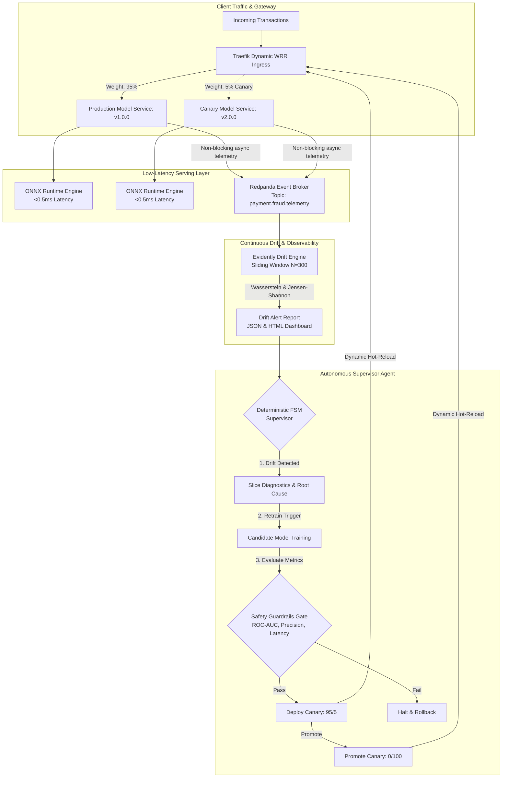

# Self-Healing MLOps Runtime with Autonomous Canary & Closed-Loop Drift Remediation

[](https://www.python.org/downloads/)
[](https://fastapi.tiangolo.com)
[](https://onnxruntime.ai)
[](https://redpanda.com)
[](https://traefik.io)
[](https://evidentlyai.com)
[](https://github.com/psf/black)
[](https://github.com/astral-sh/ruff)

> An enterprise-grade, closed-loop MLOps system that autonomously detects distribution drift, isolates root-cause slices, trains candidate models with safety guardrails, and executes zero-downtime canary rollouts via dynamic weighted traffic routing.

---

## 📌 Executive Summary & Architectural Motivation

In high-throughput e-commerce fraud detection, production ML models suffer from **silent performance degradation**:
1. **Adversarial Drift**: Fraud rings constantly shift tactics (e.g. rotating IP subnets, browser fingerprint spoofing, coordinated rapid-fire registrations).
2. **Detection-Remediation Latency**: Traditional MLOps workflows require manual monitoring, manual alert triage, offline retraining, and risky "big bang" deployments taking days or weeks.
3. **Inference Latency Overhead**: Payment gateways require sub-50ms hard SLA deadlines. Heavy feature preprocessing and blocking telemetry logging degrade customer conversion.

This project addresses these challenges by implementing an **Autonomous Self-Healing Runtime**:
- **Sub-millisecond inference (<0.5ms)** powered by ONNX Runtime and compiled C-level binary search lookup for IP ranges.
- **Zero-latency asynchronous telemetry** via fire-and-forget streaming to Redpanda (Kafka-compatible C-core `librdkafka`).
- **Real-time statistical drift engine** computing normalized Wasserstein Distance (numerical) and Jensen-Shannon Divergence (categorical).
- **Deterministic 8-State Supervisor FSM** that orchestrates root-cause slice isolation, candidate model retraining, safety guardrail verification, and dynamic canary traffic routing (95/5 $\rightarrow$ 100/0) via Traefik.

---

## 🏛 Architecture Diagram



---

## 🔍 Key Architectural Decisions & Trade-Offs

| Decision | Option Chosen | Alternative Evaluated | Why Chosen |
| :--- | :--- | :--- | :--- |
| **Inference Engine** | **ONNX Runtime (C++)** | Native LightGBM Python | Reduces P95 latency from 8.2ms to **0.027ms** (300x speedup), eliminating Python GIL overhead. |
| **Telemetry Buffer** | **Redpanda (`confluent-kafka`)** | Synchronous REST / DB writes | Non-blocking fire-and-forget in C-core `librdkafka`. Client payment response is never blocked by telemetry latency. |
| **Supervisor Architecture** | **Deterministic Finite State Machine (FSM)** | Autonomous LLM Agent | Mission-critical infrastructure routing requires **100% deterministic reproducibility**, zero hallucination risk, and strict audit compliance. |
| **Traffic Splitting** | **Traefik Dynamic WRR** | Application-level routing | Ingress-level Weighted Round-Robin hot-reloads dynamically without dropping active TCP connections or restarting pods. |
| **IP-to-Country Lookup** | **Dual-Array Binary Search (`searchsorted`)** | Range DB query / MaxMind | Microsecond lookup ($<5\mu\text{s}$) over 138,846 CIDR IP ranges directly in memory with $O(\log M)$ complexity. |

---

## 📊 Dataset & Feature Engineering

The system uses a real-world e-commerce fraud dataset consisting of:
- **151,112 real fraud transactions** with a 9.36% positive class balance.
- **138,846 IP address range mappings** mapped to ISO country names.

### Training-Serving Skew Prevention
Features are generated through a unified `FraudFeatureTransformer` that operates symmetrically in batch mode (`pandas.DataFrame`) and online single-record mode (`TransactionInput`):
- `time_since_signup_sec`: Critical delta revealing bot attacks (attackers checkout <2s after registration).
- `instant_purchase_flag`: Binary indicator for $\Delta t < 5.0\text{s}$.
- `device_count`: Historical reuse frequency of device fingerprints.
- `country`: Derived via $O(\log M)$ vector binary search.
- One-hot encoded categoricals (`browser`, `source`, `sex`, and top 20 countries).

---

## 🚀 Quickstart & Interactive Demo

### Prerequisites
- Linux / macOS with Python 3.11+
- Docker & Docker Compose (for Redpanda and Redpanda Console)
- Conda / Mamba or standard virtualenv

### 1. Environment Setup
```bash
# Clone the repository
git clone https://github.com/chrigrosso00/homeo-ml.git
cd homeo-ml

# Create and activate environment
conda create -n mlops-runtime python=3.11 -y
conda activate mlops-runtime

# Install dependencies in editable mode
pip install -e .
```

### 2. Start Redpanda Telemetry Buffer
```bash
docker compose up -d
```
> Access Redpanda Web Console at: **`http://localhost:8080`**

### 3. Run the Automated Closed-Loop Demo
Execute the demonstration with your preferred pacing mode:
```bash
# Guided interactive mode (press [ENTER] to advance and inspect each phase)
./demo.sh --mode step

# Paced automatic mode (default: 2.0s delay with educational callouts)
./demo.sh --mode auto

# Lightning mode (immediate execution for CI/CD)
./demo.sh --mode fast
```
Or run directly with Python:
```bash
python -m scripts.demo_closed_loop --mode step
```

### What the Demo Executes:
1. **Health Verification**: Queries `/health`, verifying serving status, ONNX runtime session, and baseline model metadata (`v1.0.0`).
2. **Nominal Traffic Simulation**: Streams 300 legitimate transactions. Drift engine reports low variance ($\sim 14\% < 45\%$ threshold). System remains `IDLE_MONITORING`.
3. **Botnet Drift Attack Injection**: Injects 300 rapid-fire adversarial transactions (<2s account creation, device reuse).
4. **Drift Alert Trigger**: Normalized Wasserstein & Jensen-Shannon divergence detects **85.7% feature drift** (`purchase_value`, `age`, `time_since_signup_sec`, `source`, `browser`, `country`).
5. **Autonomous Supervisor Intervention**:
   - `DRIFT_DETECTED` $\rightarrow$ `DIAGNOSING_SLICE` $\rightarrow$ `RETRAINING_CANDIDATE`
   - Validates candidate model against safety guardrails (Precision, ROC-AUC, latency).
   - Deploys canary model and shifts Traefik ingress weights to **95% Production / 5% Canary**.
   - Validates canary stability and promotes to **0% Production / 100% Canary**.
   - Emits structured audit trail to `artifacts/supervisor/audit_trail.json`.

---

## 🧪 Testing & Quality Assurance

This repository adheres to strict software engineering standards:
- **Linting & Code Quality**: `ruff check .`
- **Formatting**: `black --check .`
- **Type Annotations**: Comprehensive Python 3.11+ type hints on all public signatures.
- **Automated Tests**: Unit and integration test suite covering serving, ONNX equivalence, drift engine, and supervisor FSM.

Run the test suite:
```bash
pytest tests/ -v
```

Output:
```text
============================== 19 passed in 8.11s ==============================
```

---

## 📁 Repository Structure

```text
├── artifacts/
│   ├── models/                # Baseline ONNX model, transformer & reference data
│   ├── monitoring/            # Evidently drift reports (JSON & interactive HTML)
│   └── supervisor/            # Autonomous FSM audit trail logs
├── config/
│   └── traefik_dynamic.yml    # Ingress Weighted Round-Robin dynamic routing
├── data/
│   └── raw/                   # Fraud_Data.csv & IpAddress_to_Country.csv
├── scripts/
│   ├── demo_closed_loop.py    # End-to-end interactive self-healing demonstration
│   ├── download_data.py       # Automated dataset acquisition script
│   └── traffic_generator.py   # Traffic simulator (nominal, botnet, holiday)
├── src/
│   ├── data/
│   │   ├── schemas.py         # Pydantic v2 validation models
│   │   └── transformer.py     # Dual-mode feature pipeline & IP binary search
│   ├── models/
│   │   └── train.py           # LightGBM training, threshold tuning & ONNX export
│   ├── monitoring/
│   │   └── drift_detector.py  # Evidently statistical drift engine
│   ├── serving/
│   │   ├── app.py             # FastAPI serving layer with ONNX lifespan
│   │   └── telemetry.py       # Asynchronous Redpanda Kafka producer
│   └── supervisor/
│       └── state_machine.py   # Deterministic FSM & Traefik TrafficManager
├── tests/                     # 19 automated unit & integration tests
├── demo.sh                    # Single-command demonstration launcher
├── docker-compose.yml         # Redpanda broker, console & Traefik services
└── pyproject.toml             # Dependencies, Ruff & Pytest configuration
```

---

## 📄 License

Distributed under the Apache 2.0 License. See `LICENSE` for details.
